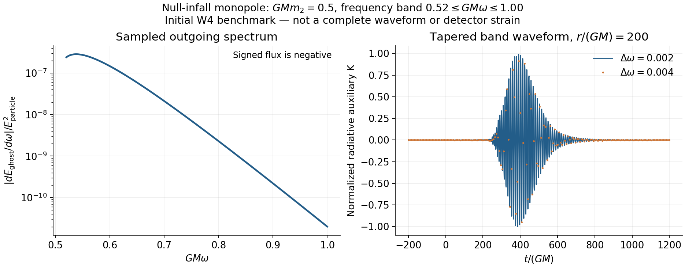

# W4 — initial null radial-infall monopole benchmark

21 November 2026. Working calculation following [W3](WEYL_RINGDOWN_POLAR_DERIVATION.md), excluded from TeX. The **initial sourced benchmark passes** its stated checks. **The full W4 gate remains open:** this is a converged propagating-frequency response and a specified band-limited waveform, not yet a complete waveform reproduction or an established suppression law.

## 1. Scope and chosen background

Retain W0's classical Einstein–Weyl theory and Schwarzschild branch. Use GM=1, F=1−2/r, x=r_*=r+2 log(r/2−1), mu=GM m2, and time dependence exp(−i omega t). The particle is null, with conserved energy E held fixed in the ultrarelativistic limit, E/M_BH≪1, and trajectory t_p=−x. This fixes the time origin. Its monopole has Y00=1/sqrt(4pi), trace T=0, and no axial source.

The production example has **mu=0.5**; additional point checks use mu=0.44 and 0.6. These are above the radial-instability threshold found in W2/W3, approximately 0.43808. A stationary real-frequency inversion on an unstable background would omit an upper-half-plane growing-mode contribution unless the contour and initial data were treated explicitly. The initial solver therefore rejects mu<0.44. This restriction is not a proof of stability of every sector or a quantum prescription for the ghost.

The response is linear in N=kappa E Y00*, where kappa=M_Pl^−2=8pi G. The solver reports K/N. In G=1 units, restoring the source amplitude multiplies by 4sqrt(pi) E. Its raw Fourier convention is hat K=integral dt exp(+i omega t) K, with inverse integral d omega/(2pi). Coefficients called K below use this convention.

## 2. Deriving the null source from the constrained tensor system

Start with W3's covariant equations, not a fitted scalar source. In units of N exp(−i omega x), the only nonzero raw stress coefficients are (T_tt,T_tr,T_rr)=(1,1/F,1/F²)/r². Conservation, the zero trace, and the angular equation allow an efficient elimination:

\[
\begin{aligned}
c&=a-2K,\\
a'&=2K'-i\omega b/F-F'(a-K)/F-2(a-3K)/r,\\
b'&=-i\omega a/F-(F'/F+2/r)b.
\end{aligned}\tag{W4.1}
\]

Differentiate these constraints before setting K or K' to zero when isolating the forcing: the derivative of 2K' contributes 2K''. Substitution into the tr and rr wave equations leaves a two-variable algebraic elimination. The independent tt equation checks the result. With

\[
D=r(2\mu^2F+\mu^4r^2+4\omega^2),
\]

the resulting equation is

\[
K''+P K'+V K=S_r,\qquad
S_r=N\,\frac{2(\mu^2r+2i\omega)}{r^2FD}\,e^{-i\omega x},
\tag{W4.2}
\]

where P,V are W3's independently checked monopole coefficients. `verify_w4_algebra.py` performs this exact elimination from the saved W3 matrix and checks the remaining wave equation.

The radial variable matters. Multiplying (W4.2) by F² gives

\[
K_{xx}+A K_x+B K=T_x,\qquad
A=FP-F',\quad B=F^2V,\quad T_x=F^2S_r.
\tag{W4.3}
\]

In AGP2026, Q0=−r²D. Stripping 4sqrt(pi) E from their Eq. (35) leaves precisely **T_x/N**, not S_r/N. Thus that displayed expression is consistent with the tortoise-coordinate equation used in their Green-function discussion. Inserting it unchanged into an r-derivative equation would introduce an erroneous F². This is an algebraic convention audit; we do not infer the authors' implementation from typography alone. Their symmetric Fourier convention must additionally be reconciled with the source prefactors before an absolute cross-code amplitude comparison. Our raw stress tensor and transform normalization are fixed independently by W3.

## 3. Retarded Green function and independent sourced integration

An exact Abel identity gives

\[
P=F'/F+5/r-D'/D,\qquad
W_r=C\frac{D}{r^5F},\qquad W_x=C\frac{D}{r^5}.
\tag{W4.4}
\]

Take h ingoing at the future horizon and o outgoing at infinity, and define W_x=h o_x−h_x o. The source solution is

\[
K(x)=o(x)\int_{-\infty}^{x}\frac{h(s)T_x(s)}{W_x(s)}ds
+h(x)\int_x^{\infty}\frac{o(s)T_x(s)}{W_x(s)}ds.
\tag{W4.5}
\]

The sign follows from the derivative jump of the Green function, which is +1. The implementation evolves homogeneous functions and source integrals together. It checks C at two interior points rather than assuming a constant ordinary Wronskian. Direct use of D/r^5 avoids inaccurate numerical cancellation of W where possible.

A second method integrates an inhomogeneous particular solution p and a homogeneous ingoing solution h from the horizon. The coefficient in K=p+c h is chosen to satisfy the outgoing, source-corrected outer boundary condition. This direct sourced shooting does not evaluate Green integrals. Both methods solve the same independently derived ODE; their agreement is an algorithmic check, not a second derivation of the theory.

## 4. Homogeneous boundaries and the source tails

For positive real omega>mu, choose k=+sqrt(omega²−mu²). The outgoing homogeneous basis is

\[
o(r)=e^{ikr}r^{p}\sum_{n=0}^N a_n r^{-n},\qquad
p=\frac{i(2\omega^2-\mu^2)}k-1,\quad a_0=1.
\tag{W4.6}
\]

Substitution into (W4.2) with zero source fixes successive a_n; the leading coefficient for each new a_n is −2ikn. The horizon basis uses W3's first regular Frobenius correction with exponent rho=−2i omega. Computation is in x so the ODE coefficients remain regular at the horizon. The inverse tortoise map uses the Wright omega function, avoiding exponential overflow at large radius. Both the threshold k=0 and the subthreshold sector require separate treatment and are excluded from this validated interface.

Crucially, the particle source extends beyond the numerical outer radius. A homogeneous outgoing Robin condition at a finite boundary incorrectly discards its exterior forced field. We derive that field as

\[
K_{\rm part}^{\infty}(r)=N e^{-i\omega x}\sum_{n=4}^{N_s}b_n r^{-n},
\qquad b_4=-2/\mu^4.
\tag{W4.7}
\]

Writing K_part=exp(−i omega x) Z(r), its radial equation has drift P−2i omega/F and potential

\[
V-\omega^2/F^2+i\omega F'/F^2-i\omega P/F.
\tag{W4.8}
\]

These terms determine the forced-series recurrence. The outer condition is

\[
K_x-L_oK=(K_{\rm part}^{\infty})_x-L_oK_{\rm part}^{\infty},
\qquad L_o=o_x/o.
\tag{W4.9}
\]

The outgoing amplitude is extracted from K−K_part, not from K alone. An exact particular solution is not claimed at a finite truncation order; both order and radius are varied.

At the horizon, epsilon=r−2 gives T_x/N=exp(−i omega x) epsilon/[16(mu²−i omega)]+O(epsilon²). The leading forced boundary correction is

\[
K_{\rm part}^{H}/N=
\frac{e^{-i\omega x}\epsilon}{16(\mu^2-i\omega)(1/4-i\omega)}+O(\epsilon^2).
\tag{W4.10}
\]

It is included alongside the free ingoing homogeneous amplitude. The production solver uses x_left=−35, r_outer=400, homogeneous order 8 and forced order 14; refinements extend to x_left=−40, r_outer=800, and orders 10 and 16.

This correction is essential for a suppression study: at mu=0.5, omega=1, simply cutting off the source at r=200 gives an outgoing-amplitude error of approximately **88%** relative to the corrected result. Agreement of two solvers with the same wrong truncated boundary would not reveal that error.

## 5. Saved benchmark and validation

All frequencies and amplitudes here are dimensionless in GM units. A_out denotes the coefficient of the unit-normalized basis (W4.6), divided by N. Selected refined values are:

| mu | omega | Re A_out | Im A_out |
|---|---:|---:|---:|
| 0.44 | 0.484 | −1.017982036×10^−3 | −4.284322909×10^−4 |
| 0.50 | 0.550 | −3.731623985×10^−4 | −1.496614717×10^−4 |
| 0.50 | 0.700 | −1.131813033×10^−5 | −2.967927504×10^−5 |
| 0.50 | 1.000 | −1.789557523×10^−7 | −2.977501410×10^−7 |
| 0.60 | 0.840 | −2.044113281×10^−6 | −3.702456631×10^−6 |

The declared acceptance limit for both independent-method agreement and final boundary refinement is relative error 2×10^−5 at these points. The observed method differences are below 2.4×10^−9 and the final refinement changes below 1.0×10^−9. These record agreement, not rigorous uniform error bounds or proof of physical accuracy at every parameter. The local sourced-ODE finite-difference check has relative residual 6.3×10^−7. Forced asymptotic residuals at r≥400 are below 6.7×10^−10 for the sampled points. The spectral run's Abel-Wronskian residual stays below 7.1×10^−10.

The saved spectrum contains 241 points over **0.52≤omega≤1**, mu=0.5. The extraction radius is r=200, or r mu=100. The waveform uses the radiative outgoing component at that radius and

\[
K_{\rm band}(t)=\frac1\pi\operatorname{Re}\int_{0.52}^{1}
w(\omega)\widehat K(\omega,r) e^{-i\omega t}\,d\omega,
\tag{W4.11}
\]

with a Tukey taper of alpha=0.25 and its conjugate negative-frequency band implicit. Halving the frequency step from 0.004 to 0.002 changes the waveform by 2.23×10^−4 in relative L2 norm on −200≤t≤1200. The unwindowed complex amplitudes, full sourced field at r=200, radiative band waveform and coarser reconstruction are all saved. Windowing and omission of frequencies are part of the definition, not evidence of physical damping or a complete causal waveform. In particular, 0<omega<mu and the near-threshold continuum are absent.

### Flux and metric interpretation

The flux column imports AGP2026 Eq. (58), retaining its negative ghost-sector sign. To apply that equation's symmetric Fourier convention, use A_sym=4sqrt(pi) E A_out/sqrt(2pi), so

\[
\frac{dE_{\rm ghost}}{d\omega}=
-\frac{8\omega(\omega^2-\mu^2)^{3/2}}{\mu^2}|A_{\rm sym}|^2.
\tag{W4.12}
\]

The plot shows its magnitude for readability; the CSV stores the signed value. The sampled-band integral is approximately −2.66078×10^−8 E² in G=M_BH=1 units. This is a convention-converted diagnostic from the cited flux formula, **not an independent derivation of the quadratic stress tensor or a total radiated energy**. Absolute normalization against the authors' data remains open; normalized spectral shape is independent of an overall Fourier factor.

The GR monopole contains no freely propagating gravitational wave, although its sourced constraint/mass perturbation is present. Since h=H+2q, the massive radiative contribution is 2q; K by itself is an auxiliary angular coefficient, not detector strain. This calculation does not reconstruct the complete monopolar metric, detector geodesic deviation, or a comparable-mass merger. It does not turn existing LIGO constraints into a bound on f2, and the PS scalar toy action cannot supply this spin-two source normalization.

## 6. Artifacts, literature comparison and remaining work

- [Exact source and coordinate audit](validation/w4_source_algebra.json).
- [Validation ledger](validation/w4_validation.json), with tolerances, refinements, solver hash and software versions.
- [Complex spectrum](validation/w4_monopole_spectrum.csv) and [band waveform](validation/w4_monopole_waveform.csv).
- [Figure PDF](validation/w4_monopole_benchmark.pdf) and [solver/reproduction guide](../scripts/weyl_ringdown/README.md).

The primary benchmark is G. Antoniou, L. Gualtieri and P. Pani, *Nonperturbative suppression of beyond-General-Relativity effects in quadratic gravity*, [arXiv:2604.01631v2](https://arxiv.org/abs/2604.01631v2), especially Eqs. (32)–(35), (41), (58), and Appendix C. W3 supplies the separate connection to [Brito–Cardoso–Pani (2013)](https://arxiv.org/abs/1304.6725v3) and the unstable monopole spectrum.

This pass reproduces the differential-equation/source structure with an independent tensor derivation and computes a new reproducible benchmark. It **does not yet establish numerical agreement with an identified author waveform or digitized spectrum**. Published plots are not treated as precision data. The paper's Figure 1 caption and surrounding text list differing masses, so a precise waveform comparison needs an unambiguous parameter/data choice rather than an assumed match.

The next W4 work is to resolve the threshold and subthreshold response, broaden and converge the frequency integration, validate the relevant damped poles if using a modal interpretation, settle absolute normalization against a specified author dataset or equation-level flux derivation, and reconstruct the desired physical metric quantity. Only then should a convergence-controlled mass scan test a suppression fit above the numerical floor. No suppression exponent is fitted here, and the full W4 gate remains explicitly open.
