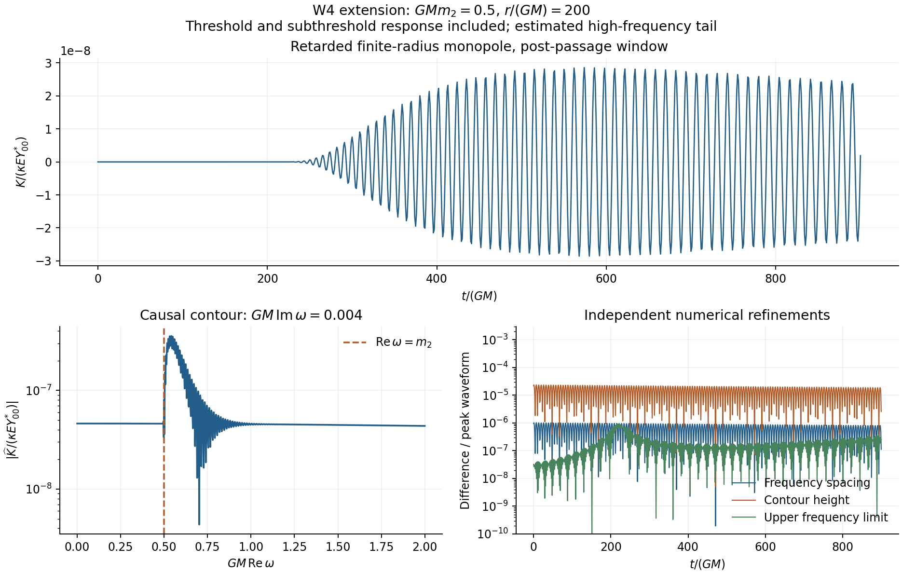

# W4 continuation — threshold, subthreshold response and extended inversion

21 November 2026. Classical working calculation, excluded from TeX. This extends the [initial null-infall benchmark](WEYL_RINGDOWN_NULL_INFALL.md), retaining its W0/W3 Einstein–Weyl conventions and independently derived source. The new result is a **threshold-inclusive finite-radius auxiliary waveform with convergence evidence on 0≤t/(GM)≤900**. The sharp null-particle-passage front and the remainder of the full W4 gate are not declared complete.

Subsequent work: the [null-front continuation](WEYL_RINGDOWN_NULL_FRONT.md) derives the leading passage behavior and adds a separate local reconstruction. The time window and validation claims in this threshold note remain unchanged.

## 1. What changes relative to the initial benchmark

The initial inversion retained only 0.52≤GM omega≤1 at mu=GM m2=0.5 and applied a Tukey taper. It could not include subthreshold fields or the mass threshold, and its outgoing power series contained inverse powers of k=sqrt(omega²−mu²).

The extension retains mu=0.5 and r_obs=200. It computes the **full sourced K at finite radius**, not just a homogeneous outgoing amplitude. It includes the imaginary-axis endpoint and uses two causal contours omega=u+i sigma with sigma=0.004 and 0.003. The finest sampled grid spans 0≤u≤2 with spacing 0.001. No Tukey taper or gap around the threshold is used. A phase-aware high-frequency tail estimate is validated separately from the sampled integral.

The output remains K/(kappa E Y00*), with kappa=8pi G and the raw Fourier convention of W3/W4. It is neither metric strain nor a new quantum prescription for the ghost. The Schwarzschild branch remains restricted to mu≥0.44 for this stationary calculation; the tests do not establish global stability in every sector.

## 2. The long-range equation and why the old expansion fails

Starting from K''+P K'+V K=S_r, define

\[
s(r)=\sqrt{\frac{r^5F}{D}},\qquad U=s(r)K,
\qquad Q=V-\frac12P'-\frac14P^2.
\tag{W4T.1}
\]

Here the prime is an r derivative, F=1−2/r and D=r(2mu²F+mu⁴r²+4omega²). Uppercase U is the normal-form field; lowercase u below denotes the real frequency coordinate. In vacuum,

\[
U''+Q U=0,\quad
Q=k^2+\frac{a}{r}+\frac{b}{r^2}+O(r^{-3}),
\quad k^2=\omega^2-\mu^2,
\tag{W4T.2}
\]

\[
a=2(2\omega^2-\mu^2),\qquad
b=12\omega^2-4\mu^2-2-\frac{4\omega^2}{\mu^2}.
\tag{W4T.3}
\]

These coefficients are verified symbolically from the saved monopole equation. Keeping the attractive 1/r term is essential: the zero-k limit is not obtained by replacing exp(ikr) with a constant in the old expansion.

### Above and below the threshold

Choose the retarded branch Im k>0 in the upper omega half-plane, with k>0 for real omega>mu. For real 0≤omega<mu, k=i chi, chi=sqrt(mu²−omega²), and the homogeneous infinity condition is **decay**, not an outgoing propagating wave:

\[
K\sim e^{-\chi r}r^{a/(2\chi)-1}.
\tag{W4T.4}
\]

The sourced field at finite radius is nonetheless nonzero. The exterior particular field of the infalling particle must still be included. No propagating-wave flux is assigned to this finite-radius subthreshold field.

Near threshold, the boundary model retains all three displayed terms of Q. With z=−2ikr and nu²=1/4−b, the selected homogeneous solution is

\[
U_{\rm C}(r)=W_{ia/(2k),\nu}(-2ikr),\qquad
\frac{K_x}{K}=F\left(\frac{U_{\rm C}'}{U_{\rm C}}-\frac P2\right).
\tag{W4T.5}
\]

This follows directly from Whittaker's differential equation; see [NIST DLMF §13.14](https://dlmf.nist.gov/13.14) and the [Coulomb-wave equation, §33.2](https://dlmf.nist.gov/33.2). The boundary includes terms through 1/r², not the entire exact potential. It must be moved outward to test the omitted terms. Away from threshold, the original inverse-radius outgoing/decaying series remains more efficient.

For real subthreshold frequencies close to mu, the turning region can be distant. For example, mu=0.5 and omega=0.4999 give an approximate turning radius a/chi²≈4996. A boundary at r=400 or 800 is not an adequate generic far-zone choice there. The saved real-axis check extends to r=12800; r=6400 and 12800 agree. Complex-contour waveform calculations avoid relying on a sparsely sampled real-axis sequence of narrow resonances.

### Exactly at the threshold

At omega=mu, a=2mu²>0. The leading normal-form solutions are sqrt(r) times Hankel functions of argument 2sqrt(ar), with order 2nu. The outgoing phase is +2sqrt(ar). Consequently

\[
U\sim r^{1/4}e^{2i\sqrt{ar}},\qquad
K\sim r^{-3/4}e^{2i\sqrt{ar}},
\tag{W4T.6}
\]

up to constant normalization and inverse-square-root corrections. It is not the ordinary fixed-k r^−1 wave. The code uses the exact potential's Riccati expansion S=U'/U=sum c_n r^(−n/2). If Q=sum Q_j r^−j at threshold, then

\[
c_1=i\sqrt{a},\quad c_2=\frac14,\qquad
2c_1c_n=\frac{n-1}{2}c_{n-1}
-\sum_{j=2}^{n-1}c_jc_{n+1-j}
-\begin{cases}Q_{(n+1)/2},&n+1\text{ even},\\0,&n+1\text{ odd}.\end{cases}
\tag{W4T.7}
\]

Fourteen terms are used in the tested boundary. The Riccati equation and the full sourced solution are checked independently. The new module does not use the initial flux helper at omega=mu: the threshold normalization needs its own flux analysis, not substitution of k=0 into a fixed-k amplitude formula.

## 3. A scaled Green solver and an independent boundary-value calculation

For complex omega the ingoing homogeneous solution grows outward below threshold, while the decaying infinity solution grows when integrated inward. Naive single shooting can subtract enormous terms to obtain a small response. The new implementation only propagates each basis **to the observer**, in segments, rescaling the homogeneous field, derivative and its source integral together after each segment. All normalization factors cancel in the Green formula.

W4's exact Abel factor remains W_base=D/r^5 in x=r_*. If I_h and I_o denote the appropriately initialized source integrals, then

\[
C=\frac{h o_x-h_x o}{W_{\rm base}},\qquad
K=\frac{oI_h-hI_o}{C},\qquad
K_x=\frac{o_xI_h-h_xI_o}{C}.
\tag{W4T.8}
\]

The left integral includes the horizon particular solution. The right integral is initialized with the forced outer-boundary drive (K_part)_x−L_o K_part divided by W_base. This supplies the exterior source tail without propagating a growing basis to infinity or extracting an inappropriate subthreshold outgoing amplitude.

An independent collocation calculation solves the two-point sourced ODE as four real equations (real and imaginary parts). It imposes the same derived boundary conditions but uses no Green integrals. At small field amplitudes, an absolute collocation tolerance that appears adequate can give a poor relative comparison; the saved independent checks therefore use tolerance 2×10^−12. Segment sizes are also varied in the Green calculation.

## 4. Causal inversion without skipping subthreshold resonances

The full field is reconstructed on a Bromwich contour:

\[
K(t,r)=\frac{e^{\sigma t}}\pi\operatorname{Re}
\int_0^\infty\widehat K(u+i\sigma,r)e^{-iut}\,du,\qquad\sigma>0.
\tag{W4T.9}
\]

The other half follows from K_hat(−u+i sigma)=K_hat(u+i sigma)*. This is a contour for the **classical retarded response**. It does not assert a Feynman prescription for quantum quadratic gravity. Keeping the contour above the real axis avoids the need to individually locate every narrow subthreshold resonance before calculating a finite-time response; no pole residues are silently removed.

The particle's source factor exp(−i omega x) grows toward large positive x on this contour. This is compatible with the finite-radius Green integral: for mu>0 and sigma>0, Im sqrt((u+i sigma)²−mu²)>sigma, so the infinity Green factor decays faster than the source factor grows. The observable calculated here is at finite radius; a complex-frequency radiation amplitude at infinity is not substituted for it.

Contour heights 0.004 and 0.003 are tested. Smaller sigma makes resonant structure harder to sample; larger sigma amplifies late-time numerical errors through exp(sigma t). The agreement of the inversions, rather than an arbitrary choice of sigma, is the relevant numerical check.

## 5. High-frequency completion for a specified post-passage window

At the observer, remove the known particle-trajectory phase:

\[
B(u)=e^{i(u+i\sigma)x_{\rm obs}}\widehat K(u+i\sigma,r_{\rm obs}),
\qquad q=t+x_{\rm obs}.
\tag{W4T.10}
\]

An integration-by-parts expansion of the omitted continuum above Omega gives endpoint terms B^(n)(Omega)/(iq)^(n+1). Using these terms with a finite-step trapezoidal integral without accounting for its endpoint error can still leave visible ringing. We instead match the tail to the same discrete quadrature. With h=Delta u and z=exp(−iqh), the first three weights are

\[
d_0=h\left(\frac12+\frac{z}{1-z}\right),\quad
d_1=\frac{h^2z}{(1-z)^2},\quad
d_2=\frac{h^3z(1+z)}{2(1-z)^3}.
\tag{W4T.11}
\]

These follow by Abel-summing the geometric series and its first two moments for the endpoint Taylor expansion. As h→0 they approach 1/(iq), 1/(iq)² and 1/(iq)³. The added term is

\[
\Delta K=\frac{e^{\sigma q}}\pi\operatorname{Re}
\left[e^{-i\Omega q}\sum_{n=0}^{2}B^{(n)}(\Omega)d_n\right].
\tag{W4T.12}
\]

Endpoint derivatives are fitted over a fixed frequency width 0.04; a wider fit and different degree are checked. This is an **asymptotic high-frequency-tail estimate at large q**, not a rigorous global remainder bound or a new time-domain model. It is tested by changing the cutoff, grid spacing, fit, number of terms and contour height.

The accepted window is 0≤t≤900, for which q≥x_obs≈209.19. The null shell passes the observer at t=−x_obs. The tail expansion is not valid at that front; the implementation rejects q<50 and quadrature alias points. A separately saved raw finite-cutoff front trace is explicitly marked unvalidated. Thus the late waveform is advanced toward a full response without relabeling the unresolved passage transient as converged.

## 6. Validation and artifacts

The reproducible ledger checks exact long-range coefficients, the threshold Riccati boundary, real-axis boundary refinements from static through threshold and above, independent collocation, agreement with the initial W4 solver in its supported band, segment rescaling, and waveform convergence. The acceptance limits are 2×10^−5 for the selected relative point checks, 10^−3 in waveform relative L2 norm and 2×10^−3 relative to the peak for the principal waveform comparisons. These are numerical acceptance criteria, not physical uncertainty estimates.

All checks pass. The largest observed Green/collocation relative difference is 9.52×10^−6; the largest final boundary-refinement change is 7.65×10^−8. Agreement with the original above-threshold solver is within 3.63×10^−9. The threshold Riccati residual is below 1.14×10^−10 at the sampled radii. The validated small positive contour heights do not establish that the chosen K reduction is nonsingular at every complex frequency.

For the post-passage waveform, observed relative L2 changes are:

| Change | Relative L2 difference |
|---|---:|
| Frequency spacing 0.002 versus 0.001 | 1.27×10^−6 |
| Contour height 0.003 versus 0.004 | 2.93×10^−5 |
| Upper sampled frequency 1.5 versus 2, with tail estimate | 4.27×10^−7 |
| Two versus three endpoint-tail terms | 1.04×10^−9 |

The more aggressive cutoff at 1.2 changes the waveform by about 2.96×10^−5 and is retained as an additional diagnostic. The peak of the sampled waveform is approximately 2.85775×10^−8 in units of kappa E Y00*, at t=574. This is a normalization-specific auxiliary-field result, not a universal ringdown amplitude. The maximum tail correction on the window is about 4.06×10^−10; omitting it would introduce a substantially larger cutoff dependence.

- [Validation ledger](validation/w4_threshold_validation.json).
- [Extended waveform and comparison columns](validation/w4_extended_waveform.csv).
- Contour spectra and generation metadata: [sigma=0.004](validation/w4_contour_sigma004.csv), [interleaved fine-grid points](validation/w4_contour_sigma004_midpoints.csv), [sigma=0.003](validation/w4_contour_sigma003.csv). Each CSV has a companion JSON with settings and the solver hash.
- [Raw unresolved front trace](validation/w4_front_unresolved.csv); do not treat this as a validated prediction of the passage transient.
- [Figure PDF](validation/w4_threshold_waveform.pdf) and [reproduction commands](../scripts/weyl_ringdown/README.md).

## 7. Status and remaining scope

Threshold and subthreshold boundary handling are now implemented and tested, and the inverse transform has no low-frequency gap. The saved post-passage waveform includes all frequency sectors through the retarded contour, with the stated empirical tail treatment. Real-axis near-threshold boundaries still require radius refinement; the code does not promise a uniform approximation at every arbitrarily close resonance.

The sharp null front, arbitrarily late times, the complete metric reconstruction h=H+2q, independent absolute flux normalization, and an identified quantitative author-waveform comparison remain open. A mass-dependent suppression scan still requires a measured error floor and a chosen physical observable. No rotation, merger calibration, or f2 bound is claimed. The full W4 gate remains open, while this threshold-inclusive finite-window calculation is a reproducible further vertical slice.

The physical setup and monopole equation remain anchored to Antoniou–Gualtieri–Pani, [arXiv:2604.01631v2](https://arxiv.org/abs/2604.01631v2); the initial derivation documents the source-coordinate and Fourier-normalization audit. The long-range boundary transformation here is derived directly from that independently checked equation, with special-function conventions fixed by the NIST references above.
